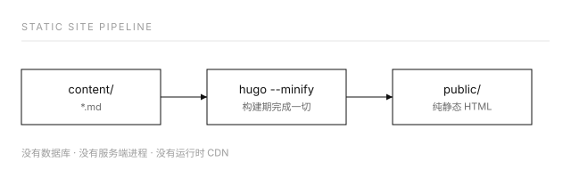

这是第一篇，就当是给自己留的说明书：把「为什么这么做」记下来，省得半年后回来一脸茫然。

## 为什么是纯静态

静态站的好处不在「快」（虽然确实快），而在于**没有东西会坏**。没有数据库、没有服务端进程、没有要定期打的补丁，生成出来的就是一堆 `.html`。哪怕哪天托管平台换了，把 `public/` 整个拷走就能继续用。

选 Hugo 而不是别的静态生成器，理由同样很朴素：

| 关注点 | Hugo 的做法 |
| --- | --- |
| 依赖 | 单个可执行文件，没有 `node_modules` |
| 构建速度 | 几十篇文章是毫秒级，改完立刻能看到 |
| 升级风险 | 主版本不兼容的情况很少，而且可以在 CI 里锁死版本 |
| 内容形态 | 全部是 Markdown，天然躺在 git 里 |

代价是模板语法（Go template）不如 JSX 亲切。但模板是一次性成本，写完基本不用再碰——这个网站的所有模板加起来也就几百行，之后每天要写的只有 Markdown。

> 判断标准很简单：**经常改的部分要和偶尔改的部分隔离开。** 经常改的是文章，偶尔改的是模板，两者不该混在一起。

## 目录就是分类

`content/posts/` 下面的文件夹结构，直接就是左侧的目录树，想嵌多深就嵌多深：

```text
content/posts/
├── tech/
│   └── this-blog/
│       └── index.md      ← 就是这篇文章
└── life/
    └── quiet-afternoon/
        └── index.md
```

新增一个分类 = 新建一个文件夹；新增一篇文章 = 新建一个文件夹放 `index.md`。用页面包（page bundle）的形式，是为了让图片能和文章放在一起，搬家的时候不会漏。

排序在模板里只写了一次：`.ByDate.Reverse`。首页、列表页、目录树、RSS 全部共用这一个规则，所以不会出现「首页顺序和列表页顺序不一样」这种别扭事。

## 数学公式

行内公式写成 `$\mathcal{O}(n \log n)$`，编译出来是这样：$\mathcal{O}(n \log n)$。行间公式用两对美元符号：

$$
T(n) = 2T\!\left(\frac{n}{2}\right) + \mathcal{O}(n) \;\Longrightarrow\; T(n) = \mathcal{O}(n \log n)
$$

$$\sum_{k=1}^{n} k = \frac{n(n+1)}{2}$$

这里有两个坑，顺手记一下：

1. Goldmark 会把 `_x_` 当成斜体，所以要在配置里开启 `passthrough`，让公式原样透传给 KaTeX，不经过 Markdown 解析。
2. KaTeX 的 CSS 和字体全部**放在自己仓库里**，不走 CDN。少一个外部依赖，就少一种「某天打开发现公式变乱码」的可能。

## 代码块

代码高亮用的是 Hugo 内置的 Chroma，样式在构建期就编译成静态 CSS，页面上不需要跑任何高亮脚本。

```go
// 一个平平无奇的例子
func Reverse(pages []Page) []Page {
	sort.SliceStable(pages, func(i, j int) bool {
		return pages[i].Date.After(pages[j].Date)
	})
	return pages
}
```

```bash
# 本地预览，含草稿
hugo server -D

# 生产构建
hugo --gc --minify
```

每个代码块右上角有个「复制」按钮，是十几行原生 JS 写的，不依赖任何库。

## 图片

图片直接放在文章同目录下，用相对路径引用就行，构建时会自动加上 `loading="lazy"` 和图片说明：



## B 站视频

贴一个视频号就能在站内播放，不用跳走：



如果不方便内嵌（比如 UP 主关了外链播放），视频下方永远留着一个「在 B 站打开」的文字链接兜底。

## 维护到底有多麻烦

日常只有三步：新建 Markdown、写内容、`git push`。剩下的构建、压缩、生成搜索索引、发布，全交给 GitHub Actions。

真正需要小心的事情只有一件：**不要把构建流程搞复杂**。每引入一个依赖，就多一个将来会让你半夜起来修的东西[^1]。

[^1]: 这条经验来自被各种「一键脚手架」坑过很多次之后的总结。
